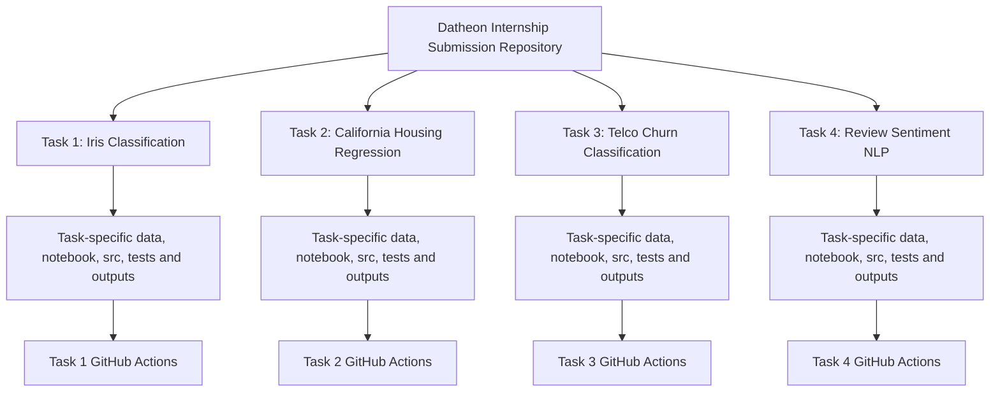

# Datheon Machine Learning & Data Science Internship — Project Submission

[](https://github.com/Subiswas36218/Datheon_Machine_Learning_Data_Science_Internship/actions/workflows/task-1-iris.yml)
[](https://github.com/Subiswas36218/Datheon_Machine_Learning_Data_Science_Internship/actions/workflows/task-2-housing.yml)
[](https://github.com/Subiswas36218/Datheon_Machine_Learning_Data_Science_Internship/actions/workflows/task-3-churn.yml)
[](https://github.com/Subiswas36218/Datheon_Machine_Learning_Data_Science_Internship/actions/workflows/task-4-sentiment.yml)
[](https://www.python.org/)
[](LICENSE)

A four-project machine-learning and data-science portfolio prepared for the Datheon internship submission. Each task is kept as a self-contained project with its own dataset, notebook, reusable source code, tests, generated outputs, dependencies and task-specific GitHub Actions workflow.

## Submission workflow from the brief

The submission instructions ask for at least two or three of the four tasks, a public GitHub repository, clear source/folder organization, and a README explaining the work. This repository includes **all four tasks**. Once the public repository is created and pushed, submit its URL in the Datheon form.

> **Repository naming note:** the screenshot suggests `Datheon_Machine_Learning_&_Data_Science_Internship`. GitHub repository names allow ASCII letters, digits, `.`, `-` and `_`, but not `&`. Use the valid slug **`Datheon_Machine_Learning_Data_Science_Internship`**. See [GitHub's repository-creation guidance](https://docs.github.com/en/repositories/creating-and-managing-repositories/creating-a-new-repository) for the allowed characters.

Create the public repository with that valid name, then from the extracted bundle directory run:

```bash
git init
git add .
git commit -m "Add Datheon machine learning internship projects"
git branch -M main
git remote add origin https://github.com/Subiswas36218/Datheon_Machine_Learning_Data_Science_Internship.git
git push -u origin main
```

After the first push, GitHub Actions will pick up the four workflow files. The path filters run only the workflow for the task directory (or workflow file) that changed; each can also be started manually from the **Actions** tab.

## Projects at a glance

| Task | Project | Main technique | Main notebook |
|---|---|---|---|
| 1 | [Iris Classification](iris-classification-pipeline/README.md) | Logistic Regression, Decision Tree | [`iris_classification_final_detailed.ipynb`](iris-classification-pipeline/notebooks/iris_classification.ipynb) |
| 2 | [California Housing Regression](california-housing-ridge-lasso/README.md) | OLS, Ridge, Lasso, GridSearchCV | [`real_estate_housing_price_prediction.ipynb`](california-housing-ridge-lasso/notebooks/real_estate_housing_price_prediction.ipynb) |
| 3 | [Telco Customer Churn](telco-customer-churn-classifier/README.md) | Random Forest, XGBoost, SMOTENC | [`customer_churn_classification.ipynb`](telco-customer-churn-classifier/notebooks/customer_churn_classification.ipynb) |
| 4 | [Customer Review Sentiment](customer-review-sentiment-classifier/README.md) | NLTK, TF-IDF, MultinomialNB, Logistic Regression | [`customer_review_sentiment_classification.ipynb`](customer-review-sentiment-classifier/notebooks/customer_review_sentiment_classification.ipynb) |

## Portfolio architecture



### Expandable workflow overview

<details>
<summary><strong>Task 1 — Iris: data → exploration → scaled classifiers → multiclass evaluation</strong></summary>

The workflow validates the supplied Iris CSV, explores feature distributions and relationships, performs a stratified holdout split, trains Logistic Regression and Decision Tree pipelines, and writes classification metrics and visualizations. See the [Task 1 architecture and details](iris-classification-pipeline/README.md#system-architecture).

</details>

<details>
<summary><strong>Task 2 — Housing: data → feature engineering → preprocessing → regularized regressors</strong></summary>

The workflow handles missing bedrooms, creates ratio/interaction features, applies numeric/categorical preprocessing, compares OLS/Ridge/Lasso, tunes Ridge/Lasso by cross-validation, and analyzes residuals. See the [Task 2 architecture and details](california-housing-ridge-lasso/README.md#system-architecture).

</details>

<details>
<summary><strong>Task 3 — Churn: data cleanup → preprocessing → SMOTENC → ensemble models</strong></summary>

The workflow parses `TotalCharges`, excludes the customer identifier, balances training folds with SMOTENC, compares Random Forest and XGBoost, and reports ROC-AUC, PR, confusion matrices and feature importance. See the [Task 3 architecture and details](telco-customer-churn-classifier/README.md#system-architecture).

</details>

<details>
<summary><strong>Task 4 — Sentiment: reviews → NLTK → TF-IDF → Naive Bayes / Logistic Regression</strong></summary>

The workflow normalizes review text, builds fold-local TF-IDF features, evaluates binary sentiment using out-of-fold predictions, saves model pipelines, and exposes `predict_sentiment()` for custom text. See the [Task 4 architecture and details](customer-review-sentiment-classifier/README.md#system-architecture).

</details>

## Task-specific CI workflows

All four workflows live in the root `.github/workflows/` directory because GitHub Actions discovers workflows from that location. Each workflow:

- runs on pushes and pull requests affecting its task folder or its own workflow file;
- supports manual execution with `workflow_dispatch`;
- installs that task's `requirements.txt` in a Python 3.11/3.12 matrix;
- runs the task's tests and executes its main notebook;
- uploads generated outputs as an Actions artifact.

| Workflow | File | Open workflow |
|---|---|---|
| Iris | `.github/workflows/task-1-iris.yml` | [Task 1 Actions](https://github.com/Subiswas36218/Datheon_Machine_Learning_Data_Science_Internship/actions/workflows/task-1-iris.yml) |
| Housing | `.github/workflows/task-2-housing.yml` | [Task 2 Actions](https://github.com/Subiswas36218/Datheon_Machine_Learning_Data_Science_Internship/actions/workflows/task-2-housing.yml) |
| Churn | `.github/workflows/task-3-churn.yml` | [Task 3 Actions](https://github.com/Subiswas36218/Datheon_Machine_Learning_Data_Science_Internship/actions/workflows/task-3-churn.yml) |
| Sentiment | `.github/workflows/task-4-sentiment.yml` | [Task 4 Actions](https://github.com/Subiswas36218/Datheon_Machine_Learning_Data_Science_Internship/actions/workflows/task-4-sentiment.yml) |

The workflow links and badges target the expected GitHub slug, but live status will appear only after you create the public repository and push this folder to GitHub. These files have not been pushed remotely.

## Repository structure

```text
Datheon_Machine_Learning_Data_Science_Internship/
├── .github/workflows/
│   ├── task-1-iris.yml
│   ├── task-2-housing.yml
│   ├── task-3-churn.yml
│   └── task-4-sentiment.yml
├── iris-classification-pipeline/
│   ├── data/ notebooks/ src/ tests/ outputs/ requirements.txt README.md
├── california-housing-ridge-lasso/
│   ├── data/ notebooks/ src/ tests/ outputs/ requirements.txt README.md
├── telco-customer-churn-classifier/
│   ├── data/ notebooks/ src/ tests/ outputs/ requirements.txt README.md
└── customer-review-sentiment-classifier/
    ├── data/ notebooks/ src/ tests/ outputs/ models/ requirements.txt README.md
```

## Clone and set up one task

```bash
git clone https://github.com/Subiswas36218/Datheon_Machine_Learning_Data_Science_Internship.git
cd Datheon_Machine_Learning_Data_Science_Internship
cd iris-classification-pipeline   # choose ..., ... or ...
python3 -m venv venv
source venv/bin/activate                # macOS / Linux
# venv\Scripts\activate             # Windows
python -m pip install --upgrade pip
python -m pip install -r requirements.txt
```

Each task's README documents its exact notebook, training command and test command. For Task 3 on Apple Silicon macOS, install the OpenMP runtime before importing XGBoost: `brew install libomp`. The CI workflow installs the corresponding Linux runtime on its Ubuntu runner.

## Reproducibility and limitations

The project-level READMEs document dataset sizes, evaluation metrics, data handling, model choices and caveats. In particular, Task 4 contains only nine binary-labelled reviews and its scores are not statistically reliable; Task 2's target is capped in the supplied dataset; and Task 3's decision threshold should be selected in light of the operational costs of churn-classification errors.

## License

MIT. Refer to [LICENSE](LICENSE). Dataset rights and original dataset provenance remain subject to the terms under which each CSV was supplied.
