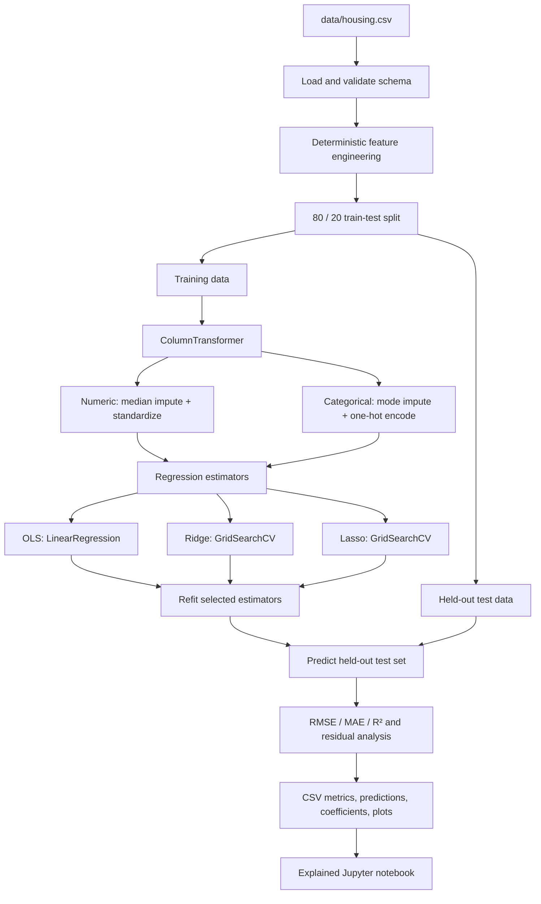

# California Housing Price Prediction — OLS, Ridge & Lasso

[](https://github.com/Subiswas36218/california-housing-ridge-lasso/actions/workflows/ci.yml)
[](https://www.python.org/)
[](https://scikit-learn.org/)
[](https://pandas.pydata.org/)
[](https://numpy.org/)
[](https://matplotlib.org/)
[](https://jupyter.org/)
[](LICENSE)

A complete, reproducible regression project for predicting California census-block-group median house values using **Ordinary Least Squares (OLS)**, **Ridge (L2)**, and **Lasso (L1)** regression. It uses the supplied `housing.csv`, engineers household ratios and interaction terms, imputes missing values, encodes categorical data, tunes regularization strength with `GridSearchCV`, and evaluates test-set predictions and residuals.

> **Scope:** This repository implements the supplied Task 2 brief. It uses the recommended scikit-learn estimators `LinearRegression`, `Ridge`, `Lasso`, and `GridSearchCV`. Pandas/NumPy are used for CSV handling and deterministic feature calculations; Matplotlib is used for visualisation. It does not introduce a different model family.

## Project highlights

- 20,640 California Housing records and 10 original columns.
- Median imputation of the 207 missing `total_bedrooms` values inside the pipeline.
- Numeric standardization and one-hot encoding of `ocean_proximity`.
- Household ratio features and selected interaction features.
- Correlation analysis to inspect multicollinearity.
- 80/20 train/test split with a fixed random seed.
- 3-fold `GridSearchCV` for Ridge and Lasso alpha values.
- Model comparison using RMSE, MAE, and R².
- Predicted-vs-actual, residual-distribution, residual-vs-predicted, coefficient, and alpha-search plots.
- GitHub Actions CI for Python 3.11 and 3.12, unit/integration tests, and notebook execution.

## Results on the supplied dataset

The final notebook was executed against the included `data/housing.csv`. On the fixed 80/20 split (`random_state=42`), the recorded metrics are:

| Model | Test RMSE (lower is better) | Test MAE (lower is better) | Test R² (higher is better) | Selected alpha |
|---|---:|---:|---:|---:|
| OLS (`LinearRegression`) | $67,010.38 | $48,122.06 | 0.6573 | — |
| Ridge (`Ridge`) | $67,027.03 | $48,138.93 | 0.6572 | 0.1 |
| Lasso (`Lasso`) | $67,528.21 | $48,306.58 | 0.6520 | 300 |

**Interpretation:** OLS has the lowest test RMSE in this run. Ridge is almost tied, while Lasso is somewhat weaker on this split. The OLS/Ridge gap is very small; regularization can still be useful for coefficient stability when predictors are correlated. These results are specific to this random split and the alpha grids listed below, not a guarantee of performance on new geographic regions.

## Dataset profile

File: `data/housing.csv`

| Property | Observed value |
|---|---:|
| Rows | 20,640 |
| Original columns | 10 |
| Numeric predictors | 8 |
| Categorical predictors | 1 |
| Target | `median_house_value` |
| Missing values | 207 in `total_bedrooms` |
| `ocean_proximity` categories | 5 |
| Rows at target maximum ($500,001) | 965 (about 4.68%) |

`median_house_value` is the response. The maximum value of `$500,001` occurs in 965 rows and acts as a ceiling in the provided target. Treat results at the high end cautiously: the CSV cannot distinguish underlying values beyond the recorded ceiling.

### Original columns

| Column | Description |
|---|---|
| `longitude`, `latitude` | Geographic coordinates |
| `housing_median_age` | Median housing age |
| `total_rooms`, `total_bedrooms` | Aggregate rooms and bedrooms |
| `population`, `households` | Aggregate population and household counts |
| `median_income` | Median income in the dataset's units |
| `ocean_proximity` | Categorical ocean-proximity label |
| `median_house_value` | Target variable |

These rows represent census block groups, not individual home listings. Predictions should not be interpreted as precise property-level appraisals.

## Feature engineering

The project retains original predictors and adds:

| Engineered feature | Definition | Purpose |
|---|---|---|
| `rooms_per_household` | `total_rooms / households` | Normalize room count by households |
| `bedrooms_per_room` | `total_bedrooms / total_rooms` | Represent bedroom share |
| `population_per_household` | `population / households` | Represent household size |
| `rooms_per_person` | `total_rooms / population` | Normalize rooms by population |
| `income_x_rooms_per_household` | `median_income × rooms_per_household` | Income/space interaction |
| `income_x_housing_age` | `median_income × housing_median_age` | Income/age interaction |
| `latitude_x_longitude` | `latitude × longitude` | Simple geographic interaction |

Zero denominators are treated as missing. The imputer handles any resulting missing values within the model pipeline. Feature engineering is deterministic and does not use the target variable.

## Modelling approach

All three estimators share the same preprocessing structure:

1. **Numeric predictors:** median imputation, then `StandardScaler`.
2. **Categorical predictor:** most-frequent imputation, then `OneHotEncoder(handle_unknown="ignore")`.
3. **OLS:** `LinearRegression` baseline.
4. **Ridge:** `GridSearchCV` across alpha values `[0.1, 1, 10, 100]`.
5. **Lasso:** `GridSearchCV` across alpha values `[100, 300, 1000, 3000]`.

Grid search uses 3-fold cross-validation with negative RMSE as the scoring function. Preprocessing is inside each scikit-learn pipeline, so the imputation/scaling/encoding steps are fitted within training folds. A separate 20% test set is not used for alpha selection.

### Multicollinearity

The correlation heatmap highlights overlapping information among several aggregate count variables. In the supplied data, `total_bedrooms` and `households` have a correlation of approximately 0.98, while `total_rooms` and `total_bedrooms` are approximately 0.93. Ridge and Lasso are included to compare the effects of L2 and L1 regularization; no feature is removed merely because one pairwise correlation is high.

## Visual analysis

The notebook creates and interprets the following 13 plots:

| # | Plot | What it helps assess |
|---:|---|---|
| 1 | Missing-value counts | Missingness pattern and imputation need |
| 2 | Target histogram and boxplot | Skew, spread, outliers, and target ceiling |
| 3 | Numeric predictor distributions | Scale differences and skewed count variables |
| 4 | Ocean-proximity category counts | Categorical imbalance |
| 5 | Geographic value scatter | Spatial clustering in recorded median values |
| 6 | Numeric correlation heatmap | Pairwise correlations and multicollinearity |
| 7 | Model metric comparison | RMSE, MAE, and R² across models |
| 8 | Alpha search CV curve | Ridge/Lasso regularization choices |
| 9 | Predicted versus actual | Calibration and prediction spread |
| 10 | Residual distributions | Bias, spread, and error tails |
| 11 | Residuals versus predicted | Patterns and non-constant residual variance |
| 12 | Best-model coefficient magnitudes | Relative fitted coefficient weights |
| 13 | Non-zero coefficient counts | Lasso sparsity comparison |

Each plot is followed by a Markdown discussion in the notebook. The static PNG files are also included under `outputs/figures/`.

## Interactive system architecture

The expandable sections below explain the main pipeline components. Expand any component to inspect its responsibility and implementation.

<details>
<summary><strong>1. Dataset ingestion and validation</strong></summary>

**Input:** [`data/housing.csv`](data/housing.csv)

The loader checks that the required columns exist, the file is not empty, and the target has no missing values.

**Implementation:** [`src/housing_price_pipeline.py`](src/housing_price_pipeline.py) — `load_dataset()`

</details>

<details>
<summary><strong>2. Feature engineering</strong></summary>

The feature builder adds per-household/per-person ratios and selected interactions. It is deterministic and does not learn statistics from the dataset.

**Implementation:** [`src/housing_price_pipeline.py`](src/housing_price_pipeline.py) — `engineer_features()`

</details>

<details>
<summary><strong>3. Train/test split and preprocessing</strong></summary>

The data is split into training and test portions. A `ColumnTransformer` applies median imputation and standardization to numeric fields, and most-frequent imputation plus one-hot encoding to `ocean_proximity`.

**Implementation:** `get_feature_columns()`, `build_preprocessor()`, and `build_model_pipelines()` in [`src/housing_price_pipeline.py`](src/housing_price_pipeline.py).

</details>

<details>
<summary><strong>4. Model training and hyperparameter search</strong></summary>

OLS is fitted as the unregularized baseline. Ridge and Lasso are wrapped in `GridSearchCV` with 3-fold validation, choosing alpha by validation RMSE.

**Implementation:** `run_experiment()` in [`src/housing_price_pipeline.py`](src/housing_price_pipeline.py).

</details>

<details>
<summary><strong>5. Evaluation and residual analysis</strong></summary>

The held-out test set is used to calculate RMSE, MAE, and R². The notebook examines predicted-versus-actual values, residual distributions, residuals versus predictions, and fitted coefficients.

**Implementation:** [`notebooks/real_estate_housing_price_prediction.ipynb`](notebooks/real_estate_housing_price_prediction.ipynb).

</details>

<details>
<summary><strong>6. Outputs and continuous integration</strong></summary>

The pipeline writes model metrics, cross-validation results, test predictions, and coefficient tables to `outputs/`. The GitHub Actions workflow runs tests and executes the notebook for Python 3.11 and 3.12.

**Implementation:** [`outputs/`](outputs/) and [`.github/workflows/ci.yml`](.github/workflows/ci.yml).

</details>

### Architecture flow



## Repository structure

```text
california-housing-ridge-lasso/
├── .github/
│   └── workflows/
│       └── ci.yml
├── data/
│   └── housing.csv
├── notebooks/
│   └── real_estate_housing_price_prediction.ipynb
├── outputs/
│   ├── best_model_coefficients.csv
│   ├── hyperparameter_search.csv
│   ├── model_comparison.csv
│   ├── test_predictions.csv
│   └── figures/
│       ├── 01_missing_values.png
│       ├── ...
│       └── 13_nonzero_coefficients.png
├── src/
│   ├── __init__.py
│   └── housing_price_pipeline.py
├── tests/
│   └── test_pipeline.py
├── .gitignore
├── LICENSE
├── README.md
└── requirements.txt
```

## Setup and execution

### 1. Clone the repository

```bash
git clone https://github.com/Subiswas36218/Datheon_Machine_Learning_Data_Science_Internship.git
cd Datheon_Machine_Learning_Data_Science_Internship
cd california-housing-ridge-lasso
```

### 2. Create and activate a virtual environment

**macOS / Linux**

```bash
python3 -m venv venv
source venv/bin/activate
```

**Windows PowerShell**

```powershell
py -m venv venv
venv\Scripts\Activate.ps1
```

### 3. Install dependencies

```bash
python -m pip install --upgrade pip
python -m pip install -r requirements.txt
```

### 4. Run the notebook

```bash
jupyter notebook notebooks/real_estate_housing_price_prediction.ipynb
```

### 5. Execute the notebook from the terminal

```bash
jupyter nbconvert \
  --to notebook \
  --execute notebooks/real_estate_housing_price_prediction.ipynb \
  --output executed_housing_prediction.ipynb \
  --output-dir outputs \
  --ExecutePreprocessor.timeout=600
```

### 6. Run tests

```bash
python -m unittest discover -s tests -v
```

### 7. Run the pipeline programmatically

From the repository root:

```python
import sys
sys.path.insert(0, "src")

from housing_price_pipeline import run_experiment

result = run_experiment(
    dataset_path="data/housing.csv",
    output_dir="outputs",
    random_state=42,
    cv=3,
)

print(result["comparison"])
print("Best model:", result["best_model_name"])
```

## Generated outputs

| File | Description |
|---|---|
| `outputs/model_comparison.csv` | Test RMSE, MAE, R² and selected alpha |
| `outputs/hyperparameter_search.csv` | CV RMSE by Ridge/Lasso alpha |
| `outputs/test_predictions.csv` | Actual and predicted test values for all models |
| `outputs/best_model_coefficients.csv` | Coefficients for the lowest-test-RMSE model |
| `outputs/figures/*.png` | All 13 project visualizations |

Running the pipeline again will refresh the CSV results. Running the notebook regenerates the figures.

## GitHub Actions CI

The workflow at [`.github/workflows/ci.yml`](.github/workflows/ci.yml) runs on:
- Pushes to `main` or `master`.
- Pull requests targeting `main` or `master`.
- Manual `workflow_dispatch` runs.

For each of Python 3.11 and 3.12, it:
1. Checks out the repository.
2. Installs `requirements.txt`.
3. Runs unit and end-to-end integration tests.
4. Executes the full analysis notebook.
5. Uploads metrics, predictions, coefficients, plots, and the executed notebook as workflow artifacts.

The workflow badge at the top becomes live after this repository is created on GitHub and the first workflow run completes.

## Limitations and responsible interpretation

- The target ceiling at `$500,001` affects the upper end of the regression problem.
- Random splitting does not test generalization to entirely unseen geographic regions.
- The five `ISLAND` records provide limited evidence for that category.
- Correlated features can make coefficient-level explanations unstable.
- The dataset describes block groups, not individual houses.
- The model is an educational regression baseline, not a real-estate valuation service.

## License and dataset note

The project code is provided under the MIT License. The supplied `housing.csv` is included as the user-provided dataset for this project; verify its original source and redistribution terms before publishing the data file publicly. The code license does not override any separate dataset license or attribution requirements.
