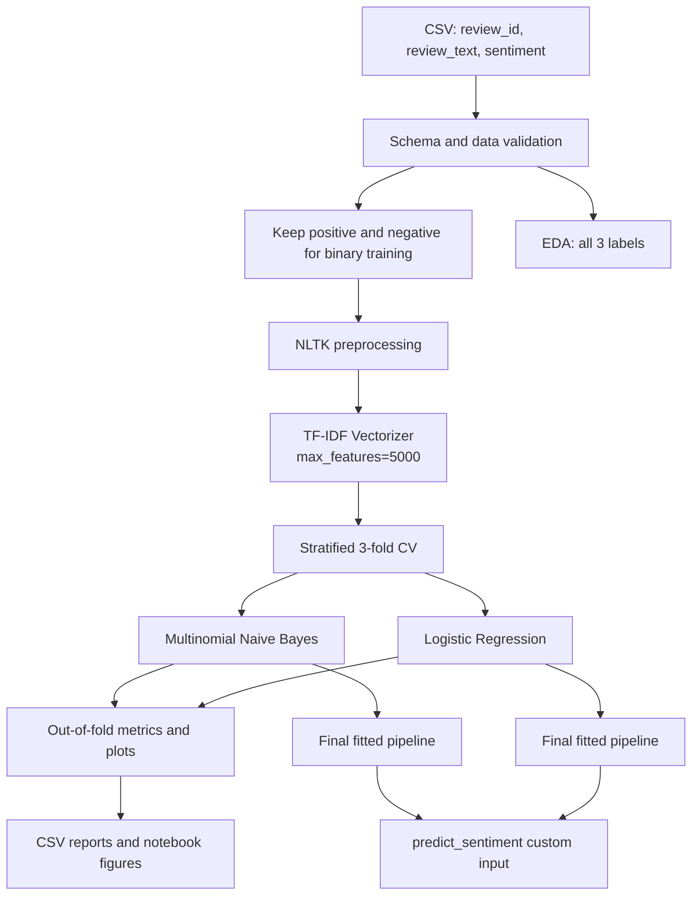

# NLP Sentiment Classification on Customer Reviews

[](https://github.com/Subiswas36218/customer-review-sentiment-classifier/actions/workflows/ci.yml)
[](https://www.python.org/)
[](https://www.nltk.org/)
[](https://scikit-learn.org/)
[](https://jupyter.org/)
[](LICENSE)

A reproducible classical NLP project that preprocesses customer reviews, converts text into TF–IDF features, and compares **Multinomial Naive Bayes** with **Logistic Regression** for positive/negative sentiment classification.

> **Dataset caveat:** the supplied CSV has only 10 reviews (5 positive, 4 negative, 1 neutral). The neutral record is retained for exploration but excluded from the requested binary model because a single example cannot support learning or validation of a neutral class. The resulting model and cross-validation scores are a workflow demonstration, not production-quality evidence.

## Task requirements addressed

The project implements the Task 4 brief:

1. Load customer/product review records from the supplied CSV.
2. Clean HTML and punctuation, lowercase and tokenize the text, remove stopwords, preserve negation, and lemmatize with NLTK WordNet when that corpus is installed.
3. Extract TF–IDF features with `max_features=5000`.
4. Train and compare `MultinomialNB` and `LogisticRegression` using scikit-learn.
5. Provide `predict_sentiment()` for live custom phrases.
6. Generate an executed notebook with accuracy benchmarks, confusion matrices, ROC and precision–recall curves, token analysis, and interpretation of every plot.

The ML/NLP stack is limited to the recommended tools in the task: **NLTK, TF-IDF, Naive Bayes, and scikit-learn**. Pandas is used for CSV/data handling, Matplotlib for the required plots, and joblib (included with scikit-learn installations) for model persistence.

## Dataset profile

Source: `data/sentiment_reviews.csv` (the user-provided file).

| Field | Type | Purpose |
|---|---|---|
| `review_id` | integer | Record identifier; excluded from model features |
| `review_text` | text | Raw customer review |
| `sentiment` | category | Ground-truth label |

| Sentiment | Records | Share |
|---|---:|---:|
| Positive | 5 | 50% |
| Negative | 4 | 40% |
| Neutral | 1 | 10% |
| **Total** | **10** | **100%** |

The supervised objective is binary positive/negative polarity. The single neutral row is not merged into either class and is not used for fitting or validation. As a result, the interactive helper returns only `positive` or `negative`.

## Observed benchmark on the supplied file

The notebook and training script use stratified 3-fold out-of-fold predictions on the nine binary-labelled records. TF–IDF is part of each scikit-learn pipeline, so vocabulary and IDF values are learned within each training fold.

| Model | Accuracy | Precision (positive) | Recall (positive) | F1 | ROC-AUC | Average precision |
|---|---:|---:|---:|---:|---:|---:|
| Multinomial Naive Bayes | 0.444 | 0.500 | 0.400 | 0.444 | 0.350 | 0.511 |
| Logistic Regression | 0.444 | 0.500 | 0.400 | 0.444 | 0.300 | 0.511 |

**Interpretation:** both models classify 4 of the 9 binary-labelled reviews correctly under this particular tiny-sample out-of-fold benchmark. One review represents 11.1 percentage points of accuracy. The results are not statistically stable, and there is no defensible winner from these values. In particular, these scores should not be interpreted as the expected performance on a larger review corpus.

## Visual outputs

The executed notebook generates 13 figures, each followed by a detailed interpretation:

| Figure | Description |
|---|---|
| [01](outputs/figures/01_sentiment_distribution.png) | Sentiment label distribution, including neutral |
| [02](outputs/figures/02_review_length_by_sentiment.png) | Review word count by sentiment |
| [03](outputs/figures/03_top_token_frequency.png) | Most frequent cleaned tokens |
| [04](outputs/figures/04_class_token_comparison.png) | Positive vs. negative token frequencies |
| [05](outputs/figures/05_top_bigrams.png) | Frequent adjacent token pairs |
| [06](outputs/figures/06_mean_tfidf_terms.png) | Highest mean TF–IDF weights |
| [07](outputs/figures/07_accuracy_benchmark.png) | Out-of-fold accuracy |
| [08](outputs/figures/08_metric_comparison.png) | Precision, recall, F1, ROC-AUC and average precision |
| [09](outputs/figures/09_confusion_matrices.png) | Out-of-fold confusion matrices |
| [10](outputs/figures/10_roc_curves.png) | ROC curves |
| [11](outputs/figures/11_precision_recall_curves.png) | Precision–recall curves |
| [12](outputs/figures/12_logistic_regression_terms.png) | Logistic Regression coefficients |
| [13](outputs/figures/13_naive_bayes_terms.png) | Naive Bayes class log-probability contrast |

## Repository structure

```text
customer-review-sentiment-classifier/
├── .github/
│   └── workflows/
│       └── ci.yml
├── data/
│   └── sentiment_reviews.csv
├── models/
│   ├── logistic_regression.joblib
│   └── multinomial_nb.joblib
├── notebooks/
│   └── customer_review_sentiment_classification.ipynb
├── outputs/
│   ├── figures/
│   │   ├── 01_sentiment_distribution.png
│   │   └── ... (13 figures)
│   └── reports/
│       ├── cross_validation_metrics.csv
│       ├── out_of_fold_predictions.csv
│       ├── logistic_regression_top_terms.csv
│       └── naive_bayes_top_terms.csv
├── src/
│   ├── sentiment_pipeline.py
│   └── train.py
├── tests/
│   └── test_pipeline.py
├── .gitignore
├── README.md
└── requirements.txt
```

## System architecture



### Explore each architecture stage (expandable)

<details>
<summary><strong>1. Data ingestion and validation</strong></summary>

`src/sentiment_pipeline.py::load_dataset` reads the user-provided CSV, checks the required columns, normalizes target labels, and fills missing review text with an empty string. `review_id` is retained for tracing predictions, but never used as a feature.

</details>

<details>
<summary><strong>2. NLTK text preprocessing</strong></summary>

`preprocess_text` decodes HTML entities, removes tags, lowercases, tokenizes through NLTK `RegexpTokenizer`, removes English stopwords, preserves negation, and uses `WordNetLemmatizer` when the WordNet corpus is available. If the corpus is unavailable, the pipeline uses a compact fallback stopword list and safely skips lemmatization; resource state is reported in the notebook.

</details>

<details>
<summary><strong>3. TF–IDF feature extraction</strong></summary>

`build_vectorizer` configures `TfidfVectorizer` with up to 5,000 features, unigrams and bigrams, and sublinear term frequency. It is wrapped inside each model pipeline so each CV fold fits its own vocabulary/IDF weights, avoiding text-vectorization leakage.

</details>

<details>
<summary><strong>4. Model training and evaluation</strong></summary>

`build_pipeline` returns a TF–IDF + `MultinomialNB` or TF–IDF + `LogisticRegression` estimator. `evaluate_with_oof` obtains stratified out-of-fold labels and probabilities, then calculates accuracy, positive-class precision/recall/F1, ROC-AUC, and average precision.

</details>

<details>
<summary><strong>5. Reporting and interactive predictions</strong></summary>

The notebook writes figures to `outputs/figures/`, benchmark tables to `outputs/reports/`, and final fitted pipelines to `models/`. `predict_sentiment()` accepts one phrase or an iterable of phrases and returns the predicted binary sentiment, maximum class probability, and positive probability.

</details>

## Setup

Python 3.11 or 3.12 is recommended.

```bash
git clone https://github.com/Subiswas36218/Datheon_Machine_Learning_Data_Science_Internship.git
cd Datheon_Machine_Learning_Data_Science_Internship
cd customer-review-sentiment-classifier

python3 -m venv venv
source venv/bin/activate        # macOS / Linux
# venv\Scripts\activate       # Windows

python -m pip install --upgrade pip
pip install -r requirements.txt
```

### NLTK corpora for full stopword removal and lemmatization

The project runs offline with a documented fallback. To enable the full NLTK English stopword list and WordNet lemmatization, run:

```bash
python -m nltk.downloader stopwords wordnet omw-1.4
```

Restart the Python interpreter or Jupyter kernel after downloading the corpora so that the preprocessing module can detect the newly installed WordNet resources.

## Matplotlib compatibility

The review-length boxplot uses `tick_labels` on Matplotlib 3.9 and newer, with a fallback to `labels` on older releases. This keeps the notebook compatible across the supported Matplotlib range.

## Run the project

### Train, benchmark and save both models

```bash
python src/train.py
```

This writes:

- `outputs/reports/cross_validation_metrics.csv`
- `outputs/reports/out_of_fold_predictions.csv`
- `models/multinomial_nb.joblib`
- `models/logistic_regression.joblib`

### Run the fully explained notebook

```bash
jupyter notebook notebooks/customer_review_sentiment_classification.ipynb
```

Run all cells from top to bottom. The notebook includes the data audit, preprocessing, EDA, TF–IDF analysis, cross-validation, 13 plots with individual interpretations, and a custom input prediction example.

### Use the live prediction helper from Python

```python
import sys
from pathlib import Path
sys.path.insert(0, str(Path("src").resolve()))

from sentiment_pipeline import load_dataset, evaluate_with_oof, predict_sentiment

reviews = load_dataset("data/sentiment_reviews.csv")
metrics, oof_predictions, trained_models = evaluate_with_oof(reviews)

print(predict_sentiment(
    ["The product is excellent and works perfectly.",
     "Terrible quality and very disappointing experience."],
    trained_models["logistic_regression"],
))
```

The helper returns only positive/negative classes; it does not detect neutral sentiment in this version.

## Tests and continuous integration

Run the same local checks used by CI:

```bash
python -m unittest discover -s tests -v
python src/train.py
```

The GitHub Actions workflow (`.github/workflows/ci.yml`) runs on pushes and pull requests to `main`/`master` and supports manual dispatch. It tests Python 3.11 and 3.12, installs requirements, downloads NLTK corpora, executes four tests, runs the training pipeline, executes the notebook with `nbconvert`, and uploads reports/models/notebook output as workflow artifacts.

The Actions badge becomes live after this project is pushed to the GitHub repository named in the badge URL. If you use a different owner/repository slug, update the badge and clone URL in this README.

## Reproducibility and limitations

- Fixed random seed: `42`.
- Validation: stratified 3-fold out-of-fold predictions on nine binary examples.
- Vectorization: fitted within each pipeline/CV training fold.
- Neutral label: retained for EDA, deliberately excluded from binary fitting (one record only).
- Metrics: highly unstable because the corpus is extremely small; no production performance claim is made.
- Model files: convenience artifacts trained on all nine binary-labelled records and not suitable for deployment without a larger, independently labelled corpus.

**Recommended next step:** add a substantially larger, independently labelled review dataset (including meaningful numbers of neutral reviews), then introduce a held-out test set before evaluating deployment readiness.
