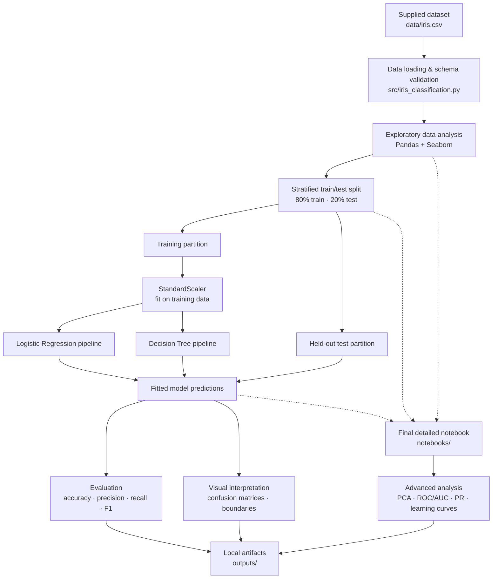

# Iris Classification Pipeline

[](https://github.com/Subiswas36218/iris-classification-pipeline/actions/workflows/ci.yml)
[](https://www.python.org/)
[](https://scikit-learn.org/)
[](https://pandas.pydata.org/)
[](https://seaborn.pydata.org/)
[](https://matplotlib.org/)
[](https://jupyter.org/)
[](LICENSE)

An end-to-end, reproducible **multi-class Iris classification project**. It combines exploratory data analysis, two supervised learning models, model evaluation, model interpretation, and a detailed Jupyter notebook with plot-by-plot discussion.

> **Repository focus:** the Iris dataset and the Logistic Regression / Decision Tree benchmark in this repository. No unrelated application services, APIs, databases, or deployment infrastructure are required.

---

## Contents

- [Project overview](#project-overview)
- [Dataset](#dataset)
- [Technology stack](#technology-stack)
- [Repository structure](#repository-structure)
- [System architecture](#system-architecture)
- [Interactive architecture guide](#interactive-architecture-guide)
- [Machine-learning workflow](#machine-learning-workflow)
- [Visual analysis](#visual-analysis)
- [Setup](#setup)
- [Run the Python pipeline](#run-the-python-pipeline)
- [Run the final notebook](#run-the-final-notebook)
- [Outputs](#outputs)
- [GitHub Actions CI](#github-actions-ci)
- [Reproducibility and leakage prevention](#reproducibility-and-leakage-prevention)
- [Limitations](#limitations)

## Project overview

The project predicts one of three Iris species from four measurements:

- Sepal length
- Sepal width
- Petal length
- Petal width

Two classifiers are trained and evaluated on the same stratified hold-out split:

1. **Logistic Regression** — trained in a pipeline with `StandardScaler`.
2. **Decision Tree Classifier** — trained in a pipeline with `StandardScaler`.

The repository includes a command-line Python implementation and Jupyter notebooks. The final detailed notebook is the recommended entry point for reviewing the complete analysis.

## Dataset

The supplied dataset is stored at [`data/iris.csv`](data/iris.csv).

| Column | Role | Description |
|---|---|---|
| `sepal_length` | Feature | Sepal length measurement |
| `sepal_width` | Feature | Sepal width measurement |
| `petal_length` | Feature | Petal length measurement |
| `petal_width` | Feature | Petal width measurement |
| `species` | Target | Iris species class |

Dataset facts verified by the project:

- 150 observations
- 4 numerical input features
- 3 target classes: `setosa`, `versicolor`, and `virginica`
- 50 observations per class
- No missing values in the supplied CSV

The loader checks the expected schema and rejects missing values instead of silently changing the data.

## Technology stack

| Technology | Use in this repository |
|---|---|
| Python | Project implementation and orchestration |
| Pandas | CSV loading, validation, tabular analysis, and metrics |
| Scikit-learn | Preprocessing, train/test splitting, classifiers, PCA, and evaluation |
| Seaborn | Statistical visualizations |
| Matplotlib | Plot rendering and saving |
| Jupyter Notebook | Interactive, documented analysis |
| GitHub Actions | Automated tests and notebook execution |

The analytical stack is intentionally limited to the libraries used by this project. `nbconvert` is installed in CI to execute the notebook as an automated validation step; it is not used by the model pipeline itself.

## Repository structure

```text
iris-classification-pipeline/
├── .github/
│   └── workflows/
│       └── ci.yml
├── data/
│   └── iris.csv
├── notebooks/
│   ├── iris_classification.ipynb
├── outputs/
│   └── classification_metrics.csv
├── src/
│   └── iris_classification.py
├── tests/
│   └── test_pipeline.py
├── .gitignore
├── README.md
└── requirements.txt
```

**Notebook guidance**

- `iris_classification.ipynb` — recommended final notebook; includes the full workflow, advanced plots, plot-by-plot interpretations, conclusions, and limitations.

## System architecture

The project is a local, batch-oriented machine-learning workflow. The CSV is read from disk, validated, explored, split, passed through preprocessing/model pipelines, evaluated, and written to local output files.



### Component responsibilities

| Component | Responsibility | Source |
|---|---|---|
| Dataset | Holds the supplied observations and labels | [`data/iris.csv`](data/iris.csv) |
| Loader | Validates columns, numeric features, missing values, and class count | [`src/iris_classification.py`](src/iris_classification.py) |
| EDA | Summarizes features and produces distribution / relationship plots | [`notebooks/iris_classification.ipynb`](notebooks/iris_classification.ipynb) |
| Split | Creates a reproducible stratified 80/20 split | Python pipeline and notebook |
| Preprocessing | Standardizes features inside each model pipeline | [`src/iris_classification.py`](src/iris_classification.py) |
| Models | Fits Logistic Regression and Decision Tree classifiers | [`src/iris_classification.py`](src/iris_classification.py) |
| Evaluation | Computes classification metrics and confusion matrices | Python pipeline and notebook |
| Advanced analysis | Computes PCA, ROC/AUC, precision-recall, learning curves, confidence, and comparison plots | Final detailed notebook |
| Artifacts | Stores plots, metric tables, and reports | `outputs/` |

## Interactive architecture guide

Use the Mermaid diagram above as the high-level system map, then follow these repository entry points to inspect each component:

<details>
<summary><strong>1. Data input and validation</strong></summary>

- Dataset: [`data/iris.csv`](data/iris.csv)
- Loader and schema checks: [`src/iris_classification.py`](src/iris_classification.py)

The loader selects the four expected features and target, checks required columns, converts features to numeric values, rejects missing values, and requires at least two target classes.
</details>

<details>
<summary><strong>2. Model training</strong></summary>

- Model factory: [`build_models()` in src/iris_classification.py](src/iris_classification.py)

Both models use a Scikit-learn `Pipeline` with `StandardScaler` followed by the classifier. The scaler is fitted on the training partition when the pipeline is trained.
</details>

<details>
<summary><strong>3. Evaluation and visual outputs</strong></summary>

- Pipeline entry point: [`run_pipeline()` in src/iris_classification.py](src/iris_classification.py)
- Final analysis: [`notebooks/iris_classification.ipynb`](notebooks/iris_classification.ipynb)

The script writes metrics, a text classification report, a pairplot, confusion matrices, and decision-boundary slices. The final notebook adds the advanced evaluation and interpretation plots.
</details>

<details>
<summary><strong>4. Continuous integration</strong></summary>

- Workflow: [`.github/workflows/ci.yml`](.github/workflows/ci.yml)
- Tests: [`tests/test_pipeline.py`](tests/test_pipeline.py)

GitHub Actions runs the unit/smoke tests and executes the final detailed notebook on Python 3.11 and 3.12 for pushes and pull requests targeting `main` or `master`.
</details>

## Machine-learning workflow

1. **Load and validate:** read the CSV and verify the expected feature/target schema.
2. **Explore:** inspect class counts, summary statistics, correlations, distributions, and pairwise relationships.
3. **Split:** create a stratified 80/20 split with `random_state=42`.
4. **Preprocess:** fit `StandardScaler` as part of each estimator pipeline using training data only.
5. **Train:** fit Logistic Regression and Decision Tree classifiers.
6. **Predict:** generate labels and probabilities for held-out observations.
7. **Evaluate:** calculate accuracy, macro and weighted precision/recall/F1, per-class reports, and confusion matrices.
8. **Interpret:** inspect feature importance, Logistic Regression coefficients, PCA, decision-boundary slices, ROC/AUC, precision-recall curves, learning curves, and prediction confidence.
9. **Export:** save plots, CSV metric tables, and text reports under `outputs/`.

## Visual analysis

The final detailed notebook contains the following visualizations, each accompanied by a discussion of what it shows and how to interpret it.

| Analysis area | Visualizations |
|---|---|
| Dataset overview | Species frequency / class balance |
| Exploratory analysis | Correlation heatmap, boxplots, violin plots, histograms, feature pairplot |
| Feature-space analysis | PCA projection |
| Model interpretation | Decision Tree feature importance, Logistic Regression coefficients, decision-boundary slices |
| Threshold-based evaluation | One-vs-rest multi-class ROC/AUC and precision-recall curves |
| Generalization | Stratified cross-validation learning curves |
| Prediction analysis | Confidence distribution and actual-vs-predicted plot |
| Model comparison | Accuracy, macro precision, macro recall, and macro F1 comparison |
| Error analysis | Confusion matrix heatmaps |

## Setup

Python 3.10 or newer is recommended.

### 1. Clone the repository

```bash
git clone https://github.com/Subiswas36218/Datheon_Machine_Learning_Data_Science_Internship.git
cd Datheon_Machine_Learning_Data_Science_Internship
cd iris-classification-pipeline
```

### 2. Create and activate a virtual environment

**macOS / Linux**

```bash
python3 -m venv venv
source venv/bin/activate
```

**Windows PowerShell**

```powershell
py -m venv venv
venv\Scripts\Activate.ps1
```

### 3. Install dependencies

```bash
python -m pip install --upgrade pip
python -m pip install -r requirements.txt
```

## Run the Python pipeline

Run from the repository root:

```bash
python src/iris_classification.py
```

Optional explicit paths:

```bash
python src/iris_classification.py --data data/iris.csv --output outputs
```

The script generates:

- `outputs/pairplot.png`
- `outputs/confusion_matrix_logistic_regression.png`
- `outputs/confusion_matrix_decision_tree.png`
- `outputs/decision_boundary_logistic_regression.png`
- `outputs/decision_boundary_decision_tree.png`
- `outputs/classification_metrics.csv`
- `outputs/classification_report.txt`

## Run the final notebook

Start Jupyter from the repository root:

```bash
jupyter notebook notebooks/iris_classification.ipynb
```

Or use JupyterLab:

```bash
jupyter lab notebooks/iris_classification.ipynb
```

Run all cells from top to bottom. The notebook writes its generated artifacts under `outputs/`.

## Outputs

The outputs are reproducible products of the supplied CSV and fixed train/test split. They are not hand-authored example plots.

| Output location | Contents |
|---|---|
| `outputs/` | Python-script plots and classification reports | Final detailed notebook plots and CSV summaries |

## GitHub Actions CI

The repository includes [`.github/workflows/ci.yml`](.github/workflows/ci.yml). It runs automatically on:

- Pushes to `main` or `master`
- Pull requests targeting `main` or `master`
- Manual dispatch from the GitHub Actions tab

The workflow uses a Python 3.11 / 3.12 matrix and performs:

1. Dependency installation from `requirements.txt`
2. Standard-library unit and end-to-end smoke tests
3. Execution of `iris_classification.ipynb` with `nbconvert`
4. Upload of generated plots and executed notebook as workflow artifacts

### Run tests locally

```bash
python -m unittest discover -s tests -v
```

### Run the notebook execution check locally

Install `nbconvert` if it is not already available:

```bash
python -m pip install nbconvert
jupyter nbconvert \
  --to notebook \
  --execute notebooks/iris_classification.ipynb \
  --output executed-final-notebook.ipynb \
  --ExecutePreprocessor.timeout=600
```

The CI badge at the top of this README becomes live after this workflow file is pushed to the GitHub repository. A badge can show “unknown” or “no status” until the first workflow run completes.

## Reproducibility and leakage prevention

- The split is stratified and uses `random_state=42`.
- `StandardScaler` is inside each Scikit-learn pipeline, so it is fitted only on the training data.
- PCA is fitted on standardized training features and then applied to the held-out test features.
- ROC and precision-recall curves use model probability outputs, not hard predicted labels.
- Learning curves use stratified cross-validation on the training partition; the final test set is not used to construct those curves.
- Decision-boundary plots vary petal length and width while holding sepal measurements at training-set medians. They are two-dimensional slices of the four-feature model, not a separate two-feature model.

## Limitations

- Iris is a small, clean benchmark dataset; performance on it does not imply production readiness.
- The held-out test set contains only 30 observations, so a single split gives a relatively coarse estimate of generalization.
- ROC/AUC and precision-recall estimates are stepwise because each class has only 10 test examples.
- Predicted probabilities are not necessarily calibrated confidence estimates.
- Tree feature importance and Logistic Regression coefficients are model-specific explanations, not causal effects.
- PCA is unsupervised and maximizes variance rather than class separation.

---

If you use or extend this project, please cite the repository and retain the dataset's provenance information.