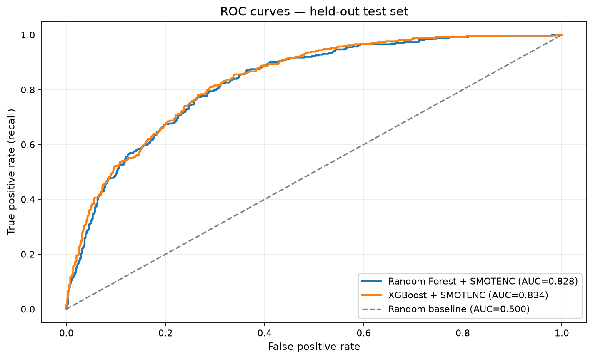
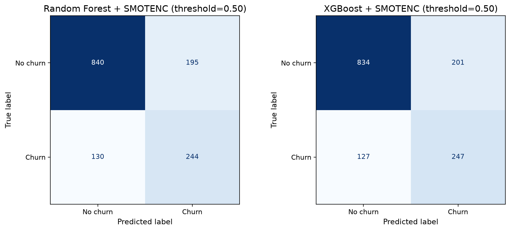
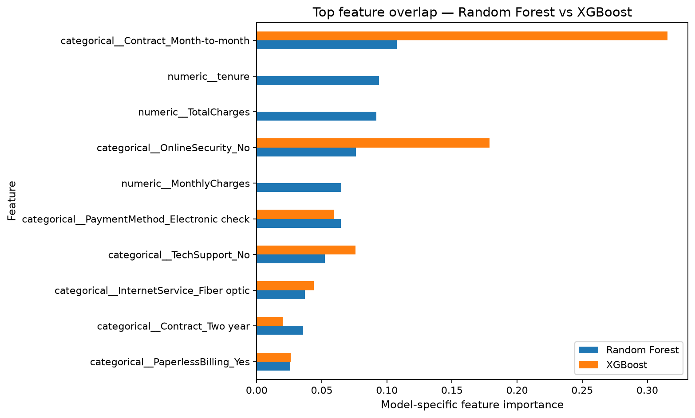
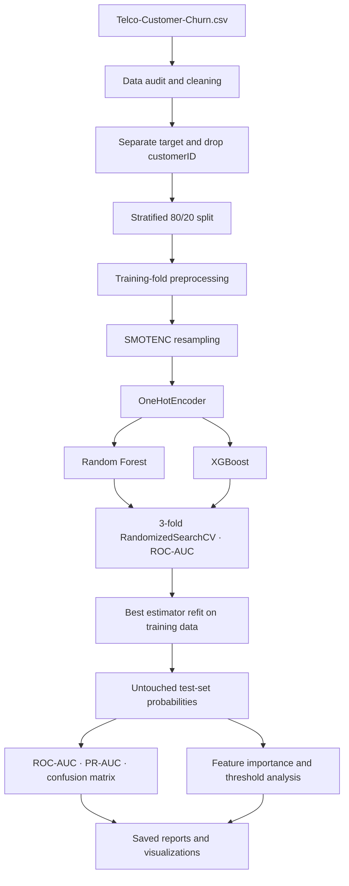

# Predictive Customer Churn Classifier

## Random Forest & XGBoost · SMOTENC · ROC-AUC

[](https://github.com/Subiswas36218/telco-customer-churn-classifier/actions/workflows/ci.yml)
[](https://www.python.org/)
[](https://scikit-learn.org/)
[](https://imbalanced-learn.org/)
[](https://xgboost.readthedocs.io/)
[](https://jupyter.org/)
[](LICENSE)

An end-to-end binary classification project that predicts customer churn from the supplied Telco Customer Churn dataset. The repository compares a **Random Forest** and an **XGBoost classifier**, handles class imbalance with **SMOTENC**, tunes both model families using stratified cross-validation, and evaluates held-out predictions with ROC-AUC, confusion matrices, precision-recall curves and feature-importance charts.

> **Task alignment:** The task image explicitly names Random Forest and XGBoost in its title and suggested approach. Its recommended-tool chips call out Scikit-learn, Random Forest, SMOTE (imbalanced-learn) and ROC-AUC. XGBoost is included because it is explicitly required by the task description; SMOTENC is used as the categorical-aware SMOTE variant because this dataset contains nominal categorical predictors.

---

## Results at a glance

<details open>
<summary><strong>Held-out test metrics (20% stratified test split, random_state=42)</strong></summary>

| Model | Accuracy | Precision | Recall | F1 | ROC-AUC | Average Precision |
|---|---:|---:|---:|---:|---:|---:|
| **XGBoost + SMOTENC** | 0.7672 | 0.5523 | 0.6497 | 0.5971 | **0.8355** | **0.6398** |
| Random Forest + SMOTENC | **0.7693** | **0.5553** | **0.6578** | **0.6022** | 0.8277 | 0.6149 |

Both classifiers exceed the task's target of **ROC-AUC > 0.80** on this held-out split. XGBoost leads on the primary ranking metric, ROC-AUC, and average precision. Random Forest is marginally stronger on the threshold-based metrics at the default probability cutoff of 0.50. These are results from one random split, not a guarantee of performance on future customers.

| Cross-validation result | Random Forest | XGBoost |
|---|---:|---:|
| Best 3-fold CV ROC-AUC | 0.8290 | **0.8384** |

</details>

### Main evaluation plots

| ROC curves | Confusion matrices |
|---|---|
|  |  |



---

## 1. Problem statement

Customer churn is the event that a customer ends a subscription. A predictive model can rank customers by estimated churn probability so a retention team can prioritize outreach, service recovery or contract interventions.

The project uses the supplied `Telco-Customer-Churn.csv` file and treats `Churn=Yes` as the positive class (`1`) and `Churn=No` as the negative class (`0`). The main objective is to optimize and report ROC-AUC while also examining precision, recall, F1, confusion matrices and influential predictors.

## 2. Dataset audit

The supplied CSV contains:

- **7,043 customer records** and **21 source columns**.
- **19 candidate predictors** after separating the target and dropping `customerID`.
- **4 numeric predictors:** `SeniorCitizen`, `tenure`, `MonthlyCharges`, `TotalCharges`.
- **15 categorical predictors:** demographic, subscription, contract, service and payment fields.
- **Target distribution:** 5,174 non-churn customers (73.46%) and 1,869 churn customers (26.54%), or approximately **2.77:1**.
- **11 whitespace-only `TotalCharges` entries**, converted to numeric missing values before imputation.

The imbalance is meaningful but not extreme. A classifier that predicts only the majority class would obtain about 73.5% accuracy while identifying no churners. This is why accuracy is not used as the only evaluation metric.

`customerID` is excluded because it is an identifier rather than a generalizable customer behaviour attribute. `TotalCharges` is converted with `pandas.to_numeric`; blank/whitespace values become missing and are imputed from training data inside the pipeline.

## 3. Modelling workflow

1. Load the supplied CSV and audit column types, missing values and target distribution.
2. Convert `TotalCharges` to numeric and drop `customerID` from the predictor matrix.
3. Create a stratified 80/20 train/test split.
4. For each cross-validation fold, impute numeric and categorical predictors using training-fold statistics.
5. Temporarily ordinal-encode categorical variables and apply SMOTENC to balance the training fold.
6. One-hot encode nominal fields after resampling.
7. Tune Random Forest and XGBoost with `RandomizedSearchCV`, using 3-fold `StratifiedKFold` and ROC-AUC scoring.
8. Evaluate the best refitted estimators once on the untouched test set.
9. Save ROC, confusion matrix, precision-recall, feature-importance and threshold-sensitivity plots plus CSV/JSON reports.

### Why SMOTENC instead of vanilla SMOTE?

The dataset mixes continuous fields with nominal categories such as `Contract`, `PaymentMethod` and `InternetService`. Plain SMOTE after one-hot encoding can interpolate dummy columns and create fractional category indicators. This project uses **SMOTENC**, which treats categorical fields as categorical when generating synthetic minority samples. Categorical values are one-hot encoded only after sampling.

The order is deliberately kept inside an `imblearn.pipeline.Pipeline`:

`Impute + ordinal encode → SMOTENC → one-hot encode → classifier`

Because the whole pipeline is passed to cross-validation, the imputer, encoders and sampler are fitted only on the training portion of each fold. The holdout test set is never resampled.

---

## 4. Interactive system architecture

The expandable stages below describe the actual flow implemented by `src/churn_pipeline.py` and the analysis notebook.



<details>
<summary><strong>Stage 1 — Source data and validation</strong></summary>

`data/Telco-Customer-Churn.csv` is the only modelling dataset. The source frame is checked for shape, data types, blank `TotalCharges` values and target class distribution. The pipeline maps `Churn` to 0/1 and excludes `customerID`.
</details>

<details>
<summary><strong>Stage 2 — Training/test isolation</strong></summary>

The split is stratified with a fixed random seed. The final test partition contains 1,409 original customer rows and remains isolated from preprocessing, SMOTENC and parameter search.
</details>

<details>
<summary><strong>Stage 3 — Mixed-type preprocessing and SMOTENC</strong></summary>

Numeric values are median-imputed. Categorical values are most-frequent-imputed and ordinal-encoded for the sampler. SMOTENC receives the categorical column positions, after which a second transformer one-hot encodes the categories. This sequence avoids interpolated one-hot dummy values.
</details>

<details>
<summary><strong>Stage 4 — Model training and cross-validation</strong></summary>

Two estimators are tuned: `RandomForestClassifier` and `XGBClassifier`. `RandomizedSearchCV` uses a stratified 3-fold split and ROC-AUC scoring. The included search is deliberately compact (`n_iter=2`) for a practical reproducible run; increase it for a more exhaustive experiment.
</details>

<details>
<summary><strong>Stage 5 — Evaluation and interpretation</strong></summary>

The notebook reports ROC-AUC, average precision, accuracy, precision, recall and F1. It creates ROC curves, confusion matrices, precision-recall curves, top-ten feature importance charts for both models, a cross-model importance comparison and a threshold-sensitivity curve.
</details>

---

## 5. Visual analysis catalogue

All 16 figures are generated by the notebook and saved in `outputs/figures/`.

| # | Figure | Purpose |
|---:|---|---|
| 01 | `01_target_class_distribution.png` | Quantifies churn imbalance and positive-class prevalence. |
| 02 | `02_tenure_distribution_by_churn.png` | Compares tenure distributions for churned and retained customers. |
| 03 | `03_monthly_charges_by_churn.png` | Compares monthly charge distributions by target class. |
| 04 | `04_churn_rate_by_contract.png` | Shows churn rate within each contract category. |
| 05 | `05_churn_rate_by_payment_method.png` | Compares churn rate by payment method. |
| 06 | `06_churn_rate_by_internet_service.png` | Compares churn rate by internet-service category. |
| 07 | `07_churn_rate_by_support_and_security.png` | Shows churn rates by security and support subscription status. |
| 08 | `08_numeric_correlation_heatmap.png` | Displays pairwise Pearson correlation among numeric predictors. |
| 09 | `09_smote_training_class_balance.png` | Compares training-fold class counts before and after SMOTENC. |
| 10 | `10_roc_curves.png` | Compares test-set ROC curves and AUC. |
| 11 | `11_confusion_matrices.png` | Shows threshold-0.50 classification outcomes. |
| 12 | `12_precision_recall_curves.png` | Shows the precision/recall trade-off for the minority class. |
| 13 | `13_random_forest_feature_importance.png` | Displays the top ten Random Forest features. |
| 14 | `14_xgboost_feature_importance.png` | Displays the top ten XGBoost features. |
| 15 | `15_feature_importance_model_comparison.png` | Compares the top feature sets across models. |
| 16 | `16_threshold_sensitivity.png` | Shows how precision, recall and F1 vary with the decision threshold. |

Each plot is followed by an interpretation section in the notebook. Feature-importance values are model-specific and non-causal; correlated features may share or redistribute importance.

## 6. Top model signals

In this run, the top Random Forest features include month-to-month contract status, tenure, total charges, absence of online security, electronic-check payment, monthly charges and absence of tech support.

The top XGBoost features include month-to-month contract status, absence of online security, electronic-check payment, fibre-optic service and absence of tech support.

These features are predictive associations in this dataset. They should not be interpreted as proof that changing a specific service or payment setting will directly prevent churn.

## 7. Repository structure

```text
telco-customer-churn-classifier/
├── .github/
│   └── workflows/
│       └── ci.yml
├── data/
│   └── Telco-Customer-Churn.csv
├── notebooks/
│   └── customer_churn_classification.ipynb
├── outputs/
│   ├── figures/
│   │   ├── 01_target_class_distribution.png
│   │   ├── ... (16 generated PNG figures)
│   │   └── 16_threshold_sensitivity.png
│   ├── reports/
│   │   ├── cross_validation_results.csv
│   │   ├── test_model_metrics.csv
│   │   ├── test_model_metrics.json
│   │   └── experiment_summary.json
│   └── customer_churn_classification.executed.ipynb
├── src/
│   └── churn_pipeline.py
├── tests/
│   └── test_pipeline.py
├── .gitignore
├── LICENSE
├── README.md
└── requirements.txt
```

## 8. Installation and execution

### Requirements

- Python 3.11 or later
- pip
- Jupyter Notebook / JupyterLab

### Setup

```bash
git clone https://github.com/Subiswas36218/Datheon_Machine_Learning_Data_Science_Internship.git
cd Datheon_Machine_Learning_Data_Science_Internship
cd telco-customer-churn-classifier

python -m venv venv
```

Activate the environment:

```bash
# macOS / Linux
source venv/bin/activate

# Windows PowerShell
.venv\Scripts\Activate.ps1
```

Install dependencies:

```bash
python -m pip install --upgrade pip
python -m pip install -r requirements.txt
```

### Run the notebook

```bash
jupyter notebook notebooks/customer_churn_classification.ipynb
```

Run all cells from top to bottom. The notebook writes plots to `outputs/figures/` and reports to `outputs/reports/`.

### Run automated tests

```bash
python -m pytest -q
```

---

## 9. GitHub Actions workflow

The repository includes `.github/workflows/ci.yml` and runs on:

- Pushes to `main` or `master`.
- Pull requests targeting `main` or `master`.
- Manual `workflow_dispatch` triggers.

The workflow matrix tests Python **3.11** and **3.12**, installs `requirements.txt`, runs the automated tests, executes the Jupyter notebook with `nbconvert`, and uploads the generated figures, reports and executed notebook as workflow artifacts.

To enable the badge, create the repository under `Subiswas36218/telco-customer-churn-classifier` (or edit the badge/clone URLs to match your chosen owner and repository), commit the files and push to GitHub. The badge will reflect the first hosted Actions run; it is not marked successful merely because the workflow file exists.

## 10. Reproducibility notes

- Fixed random seed: `42`.
- Train/test split: 80/20, stratified.
- Cross-validation: 3-fold stratified CV.
- Parameter search: 2 randomized candidates per model in the default notebook run.
- Primary search objective: ROC-AUC.
- Positive label: churn (`Yes` = 1).
- Threshold-based metrics: probability threshold = 0.50.
- Resampling: SMOTENC only within the training pipeline and CV folds.

The compact search settings keep notebook execution practical. They are not intended to prove global optimality of the chosen hyperparameters.

## 11. Limitations and responsible use

1. The notebook uses a random stratified holdout rather than a later-period temporal test. A future-period validation would better represent live deployment.
2. SMOTENC creates synthetic training examples; it does not create new observed customers. All final metrics are calculated on the original untouched test customers.
3. The default 0.50 probability cutoff is not necessarily appropriate for the economics of a retention campaign. Select a production threshold on a separate validation set based on intervention cost and capacity.
4. Feature importance is not causal and can be affected by correlated predictors and categorical encoding.
5. Customer attributes can be sensitive. Evaluate model errors and retention outcomes across relevant customer groups, and use scores to support fair and transparent assistance rather than discriminatory treatment.

## License

Distributed under the MIT License. See [LICENSE](LICENSE).
